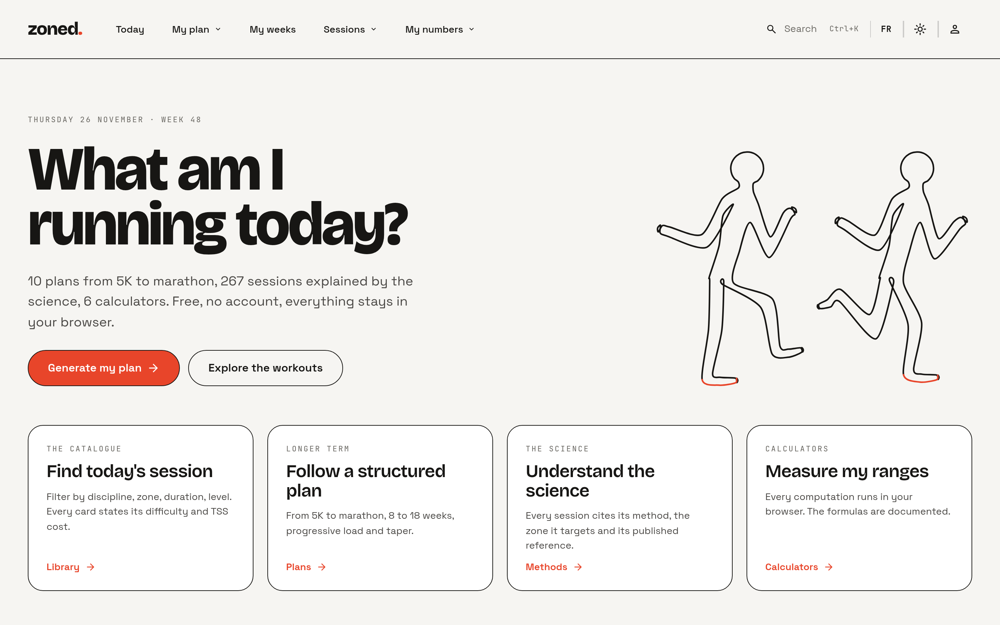
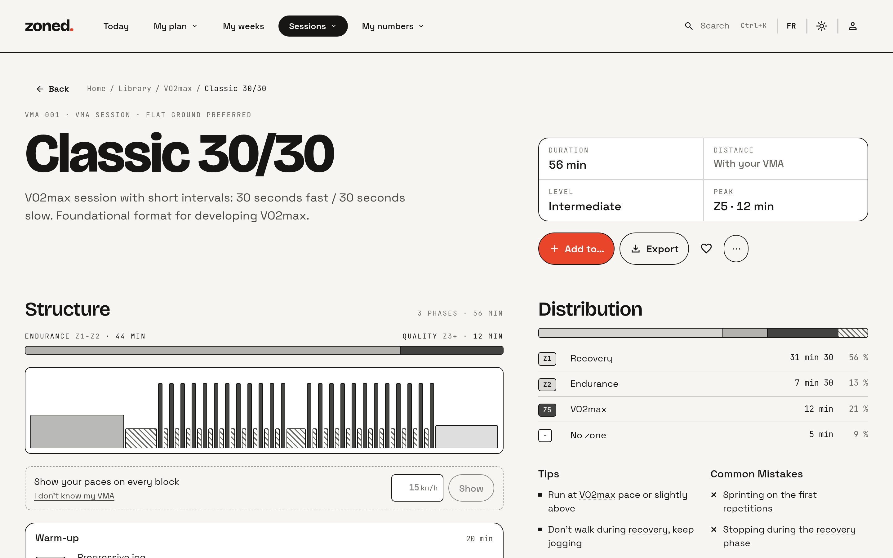
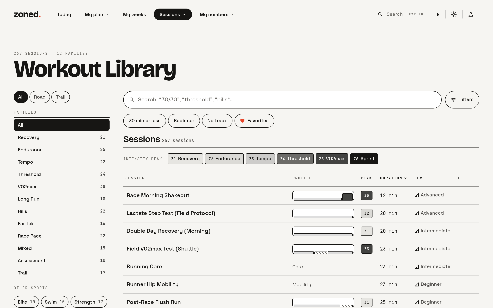

# Zoned

[](https://github.com/alarboulletmarin/zoned/releases/latest)
[](LICENSE)
[](https://creativecommons.org/licenses/by/4.0/)

Free running training plans and workouts, explained by the science. No account, no tracking: everything stays in your browser. French and English.

<picture>
  <source media="(prefers-color-scheme: dark)" srcset="assets/home_en_dark.png" />
  
</picture>

**[zoned.run](https://zoned.run)** · [English](https://zoned.run/?lang=en) · [Changelog](CHANGELOG.md) · [Agent API](docs/agent-api.md) · [Contributing](CONTRIBUTING.md)

## Why Zoned

- **A plan for your race.** 5K to marathon, road or trail. Pick one of 10 ready-made plans or let the generator build one from your date, level and days per week. Drag sessions around, block days off, and the rest of the plan reschedules.
- **267 sessions, each explained.** 230 running sessions in 12 families, plus cycling, swimming and strength. Every one shows its structure block by block, the time spent in each zone, its method and the published reference behind it (Seiler, Billat, Daniels, Coggan, Bangsbo).
- **Today, at a glance.** The cockpit shows what to run today and how the week is going: endurance, quality and strength, done against planned.
- **Your numbers.** VMA from a race time, zones, paces, treadmill, cycling FTP and swimming CSS. One model everywhere, and your numbers carry into every session and plan.
- **Race day.** A km-by-km pacing plan with gel, water and electrolyte timing, checklists and a PDF to print.
- **Take it with you.** Export a session to Garmin (`.fit`), your calendar (`.ics`), PDF or an image. Share a plan, a week or a session as a link: the whole thing is in the URL, nothing is uploaded.
- **Private by design.** No account, no analytics, no server. Your data lives in `localStorage`; back it up as one JSON file, or move it to another device with an animated QR code.
- **Works offline.** Installable as an app on a phone or a desktop.
- **Readable by AI assistants.** The catalogue is published as a static JSON API and an `llms.txt`, and a plan can be handed back as a single link. [Guide](docs/agent-api.md)

<table>
  <tr>
    <td width="50%"></td>
    <td width="50%"></td>
  </tr>
  <tr>
    <td align="center"><sub>A session, block by block</sub></td>
    <td align="center"><sub>The library</sub></td>
  </tr>
</table>

## Run it locally

Zoned is a static React app. It needs [Bun](https://bun.sh).

```bash
git clone https://github.com/alarboulletmarin/zoned.git
cd zoned
bun install
bun run dev       # http://localhost:5173
```

`bun run build` writes the site to `dist/`, every page prerendered in French and English. Any static host serves it; `vercel.json` holds the redirects and headers used in production.

## Documentation

| Page | What it covers |
|---|---|
| [CONTRIBUTING.md](CONTRIBUTING.md) | setup, checks to run before a PR, bilingual policy, workout ids |
| [docs/workout-format.md](docs/workout-format.md) | writing a session in JSON |
| [docs/agent-api.md](docs/agent-api.md) | the JSON API, `llms.txt` and the plan import link |
| [CLAUDE.md](CLAUDE.md) | architecture, build pipeline and house rules, in short |

The design notes behind each screen are listed in [docs/](docs/README.md), in French.

## Contributing

You don't need to write code. A coach or a runner can [suggest a workout](https://github.com/alarboulletmarin/zoned/issues/new?template=workout_idea.md) or [report a bug](https://github.com/alarboulletmarin/zoned/issues/new?template=bug_report.md); the form at [zoned.run/contribute](https://zoned.run/contribute) fills in the issue for you. Translations, articles and sessions come in as pull requests: read [CONTRIBUTING.md](CONTRIBUTING.md) first. For a security problem, see [SECURITY.md](SECURITY.md).

If Zoned helps you train, you can [support it on Ko-fi](https://ko-fi.com/T6T01WC5ZC). It stays free either way.

## License

The code is [MIT](LICENSE). The workouts and plans (`src/data/`) are [CC BY 4.0](https://creativecommons.org/licenses/by/4.0/): reuse them anywhere, crediting "Zoned (https://zoned.run)".

Garmin `.fit` export uses the [Garmin FIT SDK](https://developer.garmin.com/fit/), which is proprietary and restricts redistribution: read its terms before you fork or self-host. It sits behind one dynamic import in `src/lib/export/fit.ts`; dropping FIT export drops the constraint. Other third-party notices are in [THIRD-PARTY.md](THIRD-PARTY.md).
